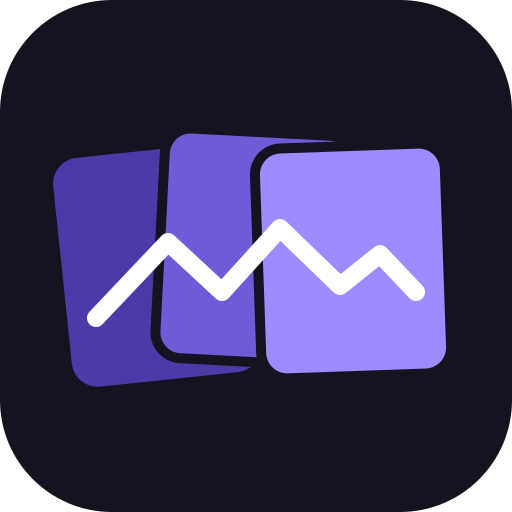

<div align="center">



# Contributing to PanoWeave

Thanks for your interest! Bug reports, ideas, test photos, documentation and code are all welcome.

[Report a bug](https://github.com/schmenn/panoweave/issues/new?template=bug_report.md) · [Suggest a feature](https://github.com/schmenn/panoweave/issues/new?template=feature_request.md) · [User guide](docs/GUIDE.md) · [Changelog](CHANGELOG.md)

</div>

## Ways to help

- **Report a bug.** Say what you did, what you expected and what happened. A screenshot, the status line text and, after a crash, the crash log the program names help most. If you can, attach or link the photos (or a few of them) and the `.pwproj` project.
- **Share photo sets that do not stitch well.** Real panoramas that fail are the best test material: wide and tele lenses mixed, water, moving people, close objects, low texture.
- **Improve the docs.** The [user guide](docs/GUIDE.md) should explain every step, setting and message. If something confused you, it probably confuses others too.
- **Write code.** For anything larger than a small fix, open an issue first so we can agree on the approach.

## Development setup

The Rust version is fixed in `rust-toolchain.toml`; `rustup` installs it (with clippy) on the first build.

```
cargo build                                   # debug builds are already optimised (opt-level 2)
cargo run -- [photos… or project.pwproj]     # start the program
cargo test                                    # unit tests
cargo clippy --all-targets -- -D warnings     # must be clean, the CI runs it
```

Useful without a window (see the README's *Command-line tools* for all of them):

- `--screenshot <file.png> --demo <name>` renders a view with the built-in sample photos; this is how the README and guide screenshots are made.
- `--selftest <photos>` runs the whole pipeline.
- `--accuracy <photos>` measures how well the photos really fit after aligning.
- `--imgdiff <a.png> <b.png>` compares two exports pixel by pixel.

Where things are: the pipeline is described in the README (*How it works*, *Project layout*); the egui interface lives in `src/app/`.

## Rules for changes

**Behaviour**

- **A new feature gets a switch.** With the switch off, the program must behave exactly as before.
- **Suggestions are never applied without the person accepting them**, and points placed by hand are never moved.
- **No silent failures.** When a pair, patch or photo is dropped, the log or the status line says why.
- **Nothing blocking in the GUI thread.** Heavy work runs on worker threads, and long steps check `engine::cancelled()` so Cancel works within about a second.

**Code**

- **Constants** live in a config struct or a documented `const`, not as scattered numbers.
- **Colours and corner radii** come only from `src/app/consts.rs`. Unit tests reject colours and radii written as numbers in the UI code.
- **Coordinates are normalised** by the long image side (`u = (x + 0.5 − w/2) / L`), so results do not depend on the resolution.
- **The export must not depend on memory:** the strip height never changes a pixel (there are tests for it).
- Edit existing files instead of adding parallel copies, and delete test output you created.
- The user interface is in English. Do not copy logos or brand names of other projects.

**Measuring**

- A change to alignment or fine alignment is judged with `--accuracy`, not with the "average error" of the points (that number also drops when points are removed).
- A change to the export is checked with `--imgdiff` against the previous version.

## Before you open a pull request

- [ ] `cargo build` without new warnings
- [ ] `cargo test` green
- [ ] `cargo clippy --all-targets -- -D warnings` clean
- [ ] New behaviour has at least one test
- [ ] Anything a user sees (a step, a setting, a message, a pitfall) is updated in [`docs/GUIDE.md`](docs/GUIDE.md), the README if needed, and the screenshots taken again with `--screenshot … --demo …`
- [ ] An entry in [`CHANGELOG.md`](CHANGELOG.md) under `[Unreleased]`

## Pull requests

- Work on a branch (`feature/…`, `fix/…`, `docs/…`, `chore/…`); pull requests are squash-merged once the CI is green.
- Describe what changed and why, how you tested it, and **what you did not check** (for example clicking through the GUI, or a code path you could not run).
- Keep commit messages and descriptions plain: no tool attribution or "generated with" lines.

## Windows tips

- A running `panoweave.exe` is locked; build into another folder meanwhile: `cargo build --release --target-dir target/other`.
- A freshly installed `gh` may be missing from the `PATH` of an already open shell.
- The release `.exe` is not code-signed, so SmartScreen may warn on a new download ("More info" → "Run anyway").
- `gen` is a reserved keyword in Rust 2024.

## License

By contributing you agree that your contribution is dual licensed under the [MIT license](LICENSE-MIT) and the [Apache License 2.0](LICENSE-APACHE), like the rest of PanoWeave, without any additional terms or conditions.
