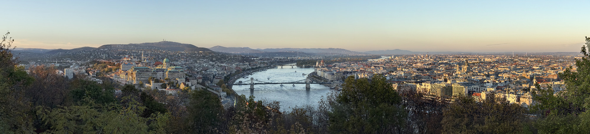
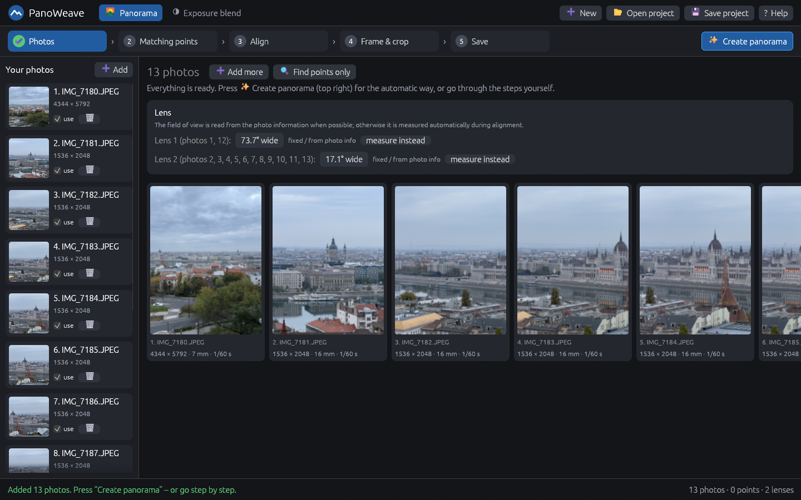
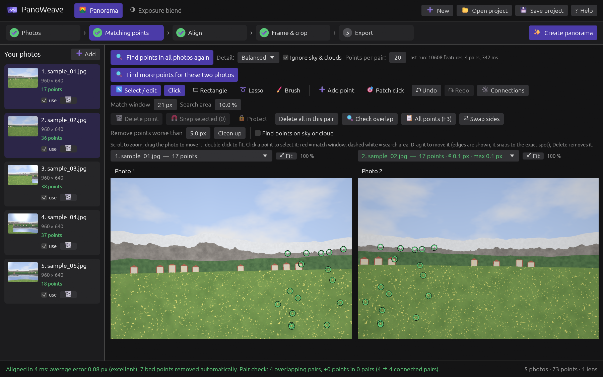
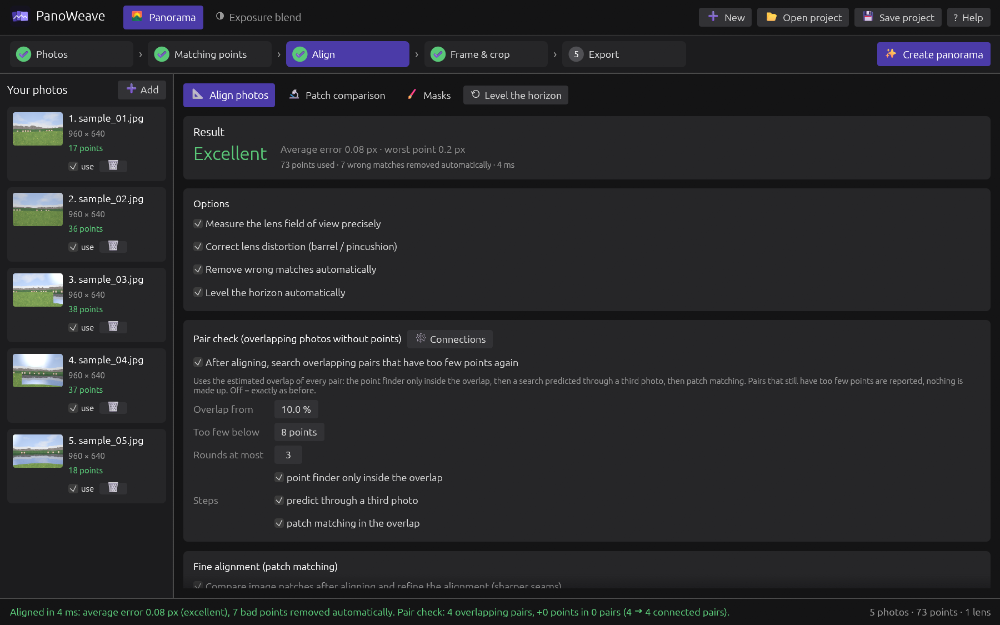
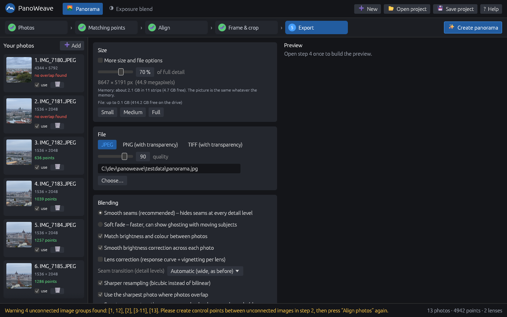
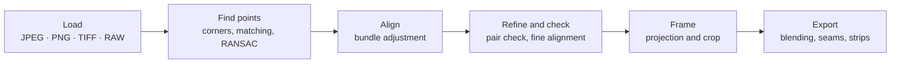

<div align="center">


# PanoWeave

**Guided panorama stitching – from a handful of photos to one panorama in five steps.**

<a href="https://github.com/schmenn/panoweave/actions/workflows/ci.yml"></a> <a href="https://github.com/schmenn/panoweave/releases/latest"></a> <a href="https://github.com/schmenn/panoweave/releases"></a> <a href="#license"></a> <a href="rust-toolchain.toml"></a>  

[Download](https://github.com/schmenn/panoweave/releases/latest) · [User guide](docs/GUIDE.md) · [Features](#features) · [Building](#building-from-source) · [Changelog](CHANGELOG.md)

</div>

<p align="center"></p>
<p align="center"><sub>Budapest from the Citadel – 21 photos, stitched with PanoWeave.</sub></p>

PanoWeave is a panorama stitcher written in Rust. It takes you through the whole job in one window – **photos → control points → align → frame → export** – with its own point detection and matching, a careful alignment and a memory-independent export. Everything happens automatically with one click, and every step can still be checked and adjusted. An **exposure fusion** mode merges bracketed shots.

> **Status:** early development (v0.3, alpha). Windows is the main platform.

## Highlights

- **Guided:** five steps with sensible defaults; *Create panorama* does all of them at once.
- **Own control points:** multi-scale corners, rotation-aware descriptors, RANSAC, a sky filter and a patch-click mode for hard pairs.
- **Precise alignment:** bundle adjustment with shared lenses, sub-pixel fine alignment, a pair check that reports weak pairs instead of hiding them.
- **Clean seams:** multi-band blending, smooth brightness correction, optional smart seams and masks.
- **Any size:** the export works strip by strip, so the picture does not depend on the computer's memory (up to BigTIFF).
- **You stay in control:** undo everywhere, protected points, and suggestions are never applied without your click.

## Quick start

1. Download the zip of the [latest release](https://github.com/schmenn/panoweave/releases/latest) and unpack it.
2. Start `panoweave.exe` and drop your photos into the window.
3. Press **Create panorama**, then check the frame and export.

New to it? The **[user guide](docs/GUIDE.md)** explains every step and setting, how to take photos that stitch well, and what to do when something goes wrong.

<details>
<summary>Windows says “Windows protected your PC”</summary>

The release `.exe` is not code-signed, so Windows SmartScreen may say "Windows protected your PC" for a new download. Click "More info", then "Run anyway". You can compare the SHA-256 checksum of the zip (`Get-FileHash <file>`) with the one in the release notes.
</details>

## Screenshots

| Photos and lenses | Control points |
|---|---|
|  |  |

| Alignment result and pair check | Export |
|---|---|
|  |  |

## Features

**Workflow and control points**

- **Guided workflow** with five steps: Photos, Points, Align, Frame, Export
- **Formats:** JPEG, PNG, TIFF and RAW (via `imagepipe`, optional `raw` feature), EXIF rotation is respected
- **Automatic control points:** multi-scale corner detection, rotation-aware descriptors, ratio-test matching, RANSAC and guided re-matching
- **No points on sky or clouds** (can be switched off); points that still sit there (placed by hand, from patch click or old projects) can be found and removed later with "Find points on sky or cloud" in the point editor or the point list (threshold, one undo step, protected points stay)
- **Point editor:** place a few points by hand and let PanoWeave find more, with sub-pixel snapping, zoom levels and a sortable point list; the patch-click mode uses the rotation and zoom of nearby points (and of the alignment), so slightly turned photos are matched too
- **Area tool:** draw a rough rectangle round the same surface (sign, number plate, wall) in both photos; the areas are compared exactly (patch matching, sub-pixel, local affine map) and points are proposed only where there is real structure, with a score each, added after your click as one undo step
- **Selecting many points:** Shift/Ctrl+click in the photos or the point list, or the selection shapes inside "Select / edit" (Click, Rectangle, Lasso, Brush). "Delete selected" removes them in one undo step, "Snap selected" lets them all snap to the exact spot in the background (protected points are left alone).
- **Protected points:** lock a point (key L) and no bulk action (clean up, delete all in a pair, outlier removal, duplicate removal, a new search, the fine alignment) removes or moves it; the fine alignment still measures it and says when one is more than 3 px off or cannot be found nearby; a locked point is also refused by single delete and drag until it is unlocked.
- **Duplicate points:** points that lie on top of each other are marked in the point list and can be removed with one click (hand-placed points stay).
- **Undo and redo** (Ctrl+Z, Ctrl+Y) for every change of the control points, in the main window and in the point list, overlap check, connection view and patch window.
- **Cancel button** that stops long steps within about a second

**Alignment and checks**

- **Alignment:** rotation model with shared lenses and Levenberg-Marquardt bundle adjustment
- **Patch matching refinement:** ZNCC/SSD/SAD matching on a pyramid with weighted rounds that are rolled back if they make things worse, plus an optional parallax mode (local correction near the seams for close objects; saved in the project file)
- **Pair check and connection graph:** weak pairs and unconnected photo groups are reported instead of hidden
- **Overlap check:** lay two photos over each other (blend, difference, checkerboard) with a brightness match and a filter for photos with finer resolution.

**Export and blending**

- **Export:** multi-band blending, gain compensation, and a seam preference for the sharpest photo; optional target width in pixels and 16-bit TIFF; a cancelled export never leaves a half-written file
- **Memory-independent export:** the panorama is made strip by strip and written straight to the file (JPEG, PNG, TIFF, BigTIFF above 3.5 GB). The strip height follows from the free memory, but it never changes a pixel, so the picture is the same whatever memory the computer has. Free disk space is checked before the export starts.
- **Smooth brightness correction across each photo:** besides one gain per photo, a smooth correction field per photo (a coarse grid, solved from the overlaps, robust against clouds and people) evens out sky gradients, vignetting and automatic exposure, so the footprints of single photos no longer show as rectangles. On by default, switchable in the export dialog (Blending).
- **Lens correction** (optional, off by default; Export step, Blending): a response curve (one exponent per colour channel) and a vignetting model per lens, solved from the overlaps of all photos. It helped on one test set and not on another, so it is an experiment, not a default.
- **Smart seams** (optional, off by default): a graph-cut seam finder searches, once for the whole panorama, where the photos agree, so that close objects that two photos see from different sides (poles, lamps, people) are not cut in two. Found on a coarse grid in two steps, so the result does not depend on the strips either.
- **Masks:** paint "use here" (green) and "do not use here" (red) masks on a photo with a brush or lasso (Export step, Blending, "Edit masks..."). Green steers the seams; a red spot is left out of the panorama completely (nothing of it is blended in), and where every photo is red there is a hole, which the preview shows and the program warns about. Saved in the project file; a "Show seams" view shows which photo wins where.

**Exposure fusion**

- **Exposure fusion** (Mertens) for bracketed exposures

## How it works



<details>
<summary>Project layout</summary>

| Module | Role |
|---|---|
| `imgutil`, `sysmem` | Loading (EXIF, RAW), 1600 px working images, memory checks |
| `features`, `guided` | Corner detection, descriptors, matching, RANSAC, sky/cloud filter |
| `engine` | Pipeline glue: find points, candidate pairs, align, cancel |
| `align`, `geometry` | Camera model and bundle adjustment |
| `patch_matcher`, `fine_align` | Patch matching and refinement |
| `pair_check`, `click_match`, `area_match` | Pair verification, patch-click mode and area mode |
| `patch_store`, `patch_viz`, `patch_window` | Patch records, heatmaps, "Patch comparison" window |
| `stitch`, `fusion` | Projection, blending, exposure fusion |
| `strip`, `strip_write`, `photo_cache` | Memory-independent export: strip planning and memory budget, streaming JPEG/PNG/TIFF writers, cache of decoded photos |
| `lensphoto` | Optional per-lens response curve and vignetting model |
| `overlap`, `duplicate_points` | Overlap check sampling; detection of points on top of each other |
| `sky_points` | Points on sky or cloud: which points to mark and which may be removed |
| `seams`, `masks` | Seam finder (graph cut) and the masks painted on photos |
| `app` | The egui user interface, split into `types`, `state`, `jobs`, `demo`, `chrome`, `pipeline`, `points_*`, `photos`, `align`, `frame`, `export`, `exposure`, `connections` |
| `main`, `accuracy_test` | Arguments and headless test drivers (`--accuracy`: the independent fit check) |

See [CONTRIBUTING.md](CONTRIBUTING.md) for development notes.
</details>

## Building from source

The Rust version is fixed in `rust-toolchain.toml`; `rustup` installs it on the first build.

```
cargo build --release
cargo run --release -- [photo1.jpg photo2.jpg ...]
```

The program is written to `target/release/panoweave.exe`. Debug builds (`cargo build`) are already optimised (`opt-level = 2`, dependencies at 3). Tests: `cargo test`; the CI also runs `cargo clippy --all-targets -- -D warnings`.

RAW photos are read with `imagepipe` / `rawloader`, which are LGPL licensed. They are built in by default (feature `raw`); `cargo build --release --no-default-features` leaves them out (JPEG, PNG and TIFF keep working).

<details>
<summary>Command-line tools and experiment switches</summary>

Start the program with image files (or a `.pwproj` project) on the command line to open them directly. Settings are stored in `%APPDATA%\PanoWeave\settings.json`.

| Flag | Purpose |
|---|---|
| `--selftest <photos>` | Run the whole pipeline without a window |
| `--loadtest` | Measure load time and memory |
| `--kpdebug`, `--pairtest` | Point detection and pair debugging |
| `--paircheck <photos>` | Pair check and triangle test |
| `--accuracy <photos>` | Measure how well the photos really fit after aligning: remaining shift on spots that are neither points nor control areas (removing points cannot improve it), per pass, optionally per pair. Use it to judge changes to the alignment; it measures on 3200 px copies of the photos (on the 1600 px working images part of the result is measuring noise); options `PW_ACC_PASSES`, `PW_ACC_PAIRS=1`, `PW_ACC_CHECK_SIZE` (default 3200), `PW_ACC_FINE_SIZE`, `PW_ACC_NO_OUTLIERS=1`, `PW_FINE_GRID`, `PW_FINE_AREAS`, `PW_FINE_ITER`, `PW_FINE_CONV` (see `src/accuracy_test.rs`) |
| `--screenshot <file.png>` | Save a screenshot after about 120 frames and exit |
| `--demo <name>` | Open a demo view (`photos`, `points`, `align`, `export`, `exposure`, `patches`, `connections`, ...) |

Environment variables for experiments: `PW_FINE`, `PW_SHARP`, `PW_PARALLAX`, `PW_SKY`, `PW_PPP` (points per photo), `PW_DEBUG`, `PW_CANCEL_TEST`, `PW_SCROLL`, `PW_RECORD=0` (do not keep the patches for the "Patch comparison" window; also a checkbox in the fine alignment settings).

Export and seam experiments (with `--screenshot ... --demo render <photos or .pwproj>`): `PW_SCALE` (percent), `PW_OUT` / `PW_OUT2` (output file of the first and of a second export), `PW_EXPORT_MB` / `PW_EXPORT_MB2` (memory budget in MB, shows that the picture does not depend on it), `PW_OLD_EXPORT=1` (render the whole picture in memory, for comparing), `PW_SAVE_PROJECT=<file.pwproj>` (keep the alignment; a `.pwproj` on the command line loads it again), `PW_SEAMS=0/1` and `PW_SEAMS2` (force smart seams off / on for the first / second export), `PW_SEAM_DATA`, `PW_SEAM_SMOOTH`, `PW_SEAM_CUT`, `PW_SEAM_POWER`, `PW_SEAM_MISSING`, `PW_SEAM_SIDE` (seam finder weights and grid), `PW_GAINS=0` (no brightness matching), `PW_GAINMAP=0/1`, `PW_GM_GRID`, `PW_GM_SMOOTH`, `PW_GM_MAXDEV` (brightness correction field), `PW_LEVELS=<n>` (blend levels), `PW_FLAT_LO` / `PW_FLAT_HI` (texture limits below which a detail advantage fades out in the seam search; `PW_FLAT_HI=0` switches it off), `PW_SEAM_DEBUG=<file.png>` (write a picture of the seams), `PW_MASK_MAP=<file.png>` (write the preview with the masks drawn in, framed like the export: orange where some photos covering a spot are masked red, magenta where all are – a hole –, green where a photo is masked green).

`panoweave --imgdiff <a.png> <b.png> [diff.png] [sheet.png]` compares two pictures pixel by pixel (maximum and mean difference, number of differing pixels), optionally writes a difference picture and a sheet of the places with the biggest differences.
</details>

## Known limitations

- Photos with no overlap to the rest are not connected automatically. Use the manual point editor.
- Smart seams cannot fix every case: where a close object is seen from very different sides and no seam can go around it, a step or ghost remains (for example a pole whose bracket lies between two rows of photos). Masks are meant for those cases.
- The strip export is about twice as slow as writing the whole picture from memory, and smart seams add some seconds. Panoramas of 1 to 2 gigapixels are planned for but not yet tested (the largest test so far is about 92 megapixels).
- The brightness correction and the seam finder even out most exposure differences between photos, but a faint soft colour edge can remain in a smooth sky where two cameras (for example a wide and a tele lens) differ in colour rendering.
- The parallax mode is off by default and only corrects small shifts (up to a few pixels) near the seams.
- A few functions in `src/app/` (`ui_align`, `graph_window`, `ui_frame`) are still long.
- A running export cannot be interrupted while the encoder is writing; a cancel takes effect afterwards and the file is discarded.

## Contributing

Contributions are welcome – see [CONTRIBUTING.md](CONTRIBUTING.md). Please read the [user guide](docs/GUIDE.md) first to know how the program is meant to work, and open an issue before a large change.

## License

Licensed under either of

- [Apache License, Version 2.0](LICENSE-APACHE)
- [MIT license](LICENSE-MIT)

at your option. Unless you explicitly state otherwise, any contribution intentionally submitted for inclusion in this project shall be dual licensed as above, without any additional terms or conditions.

The licenses of all crates PanoWeave is built from, including the LGPL crates used for RAW support, are listed in [THIRD_PARTY_LICENSES.md](THIRD_PARTY_LICENSES.md).

## Acknowledgements

PanoWeave is an independent project. It is inspired by [Hugin](https://hugin.sourceforge.io/) but contains none of its code.
