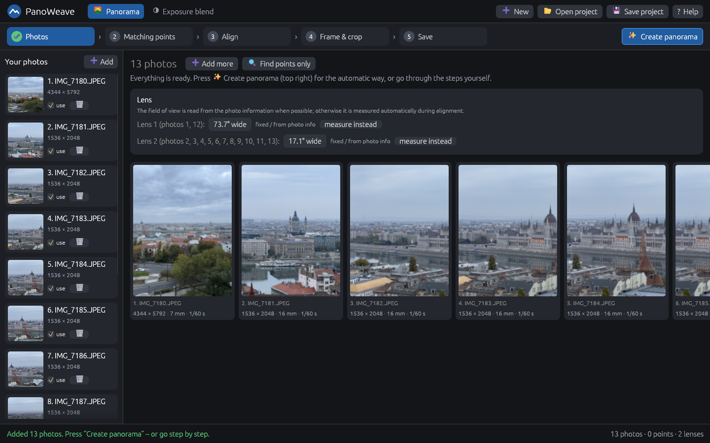
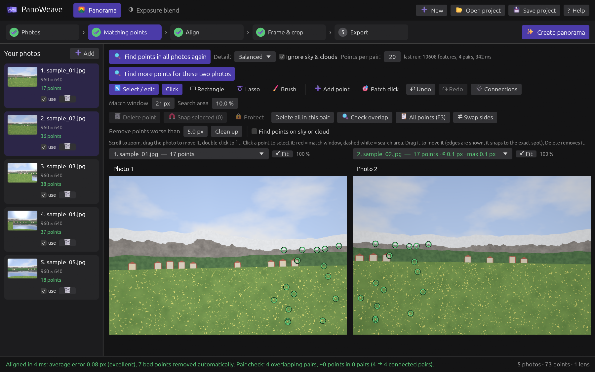
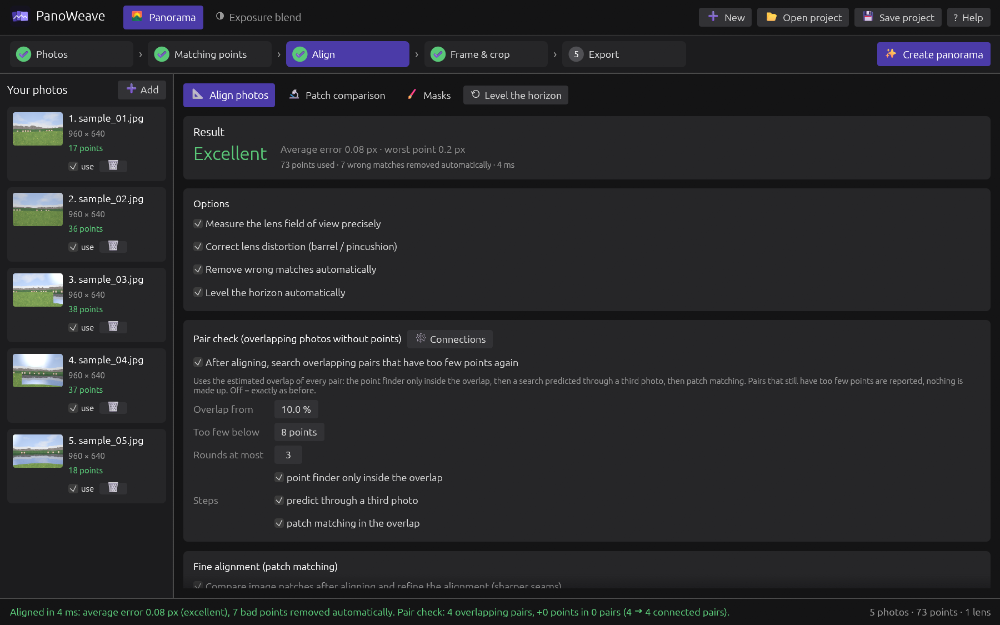
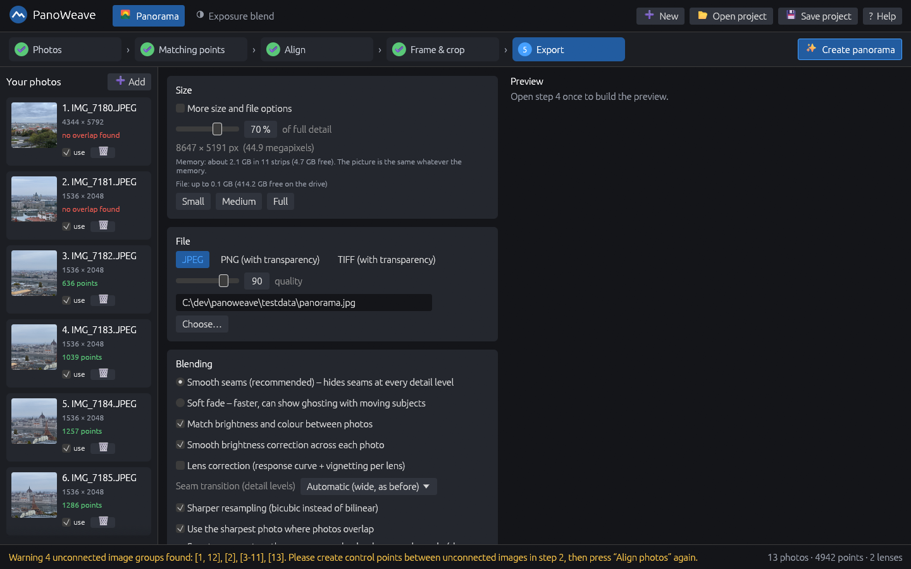
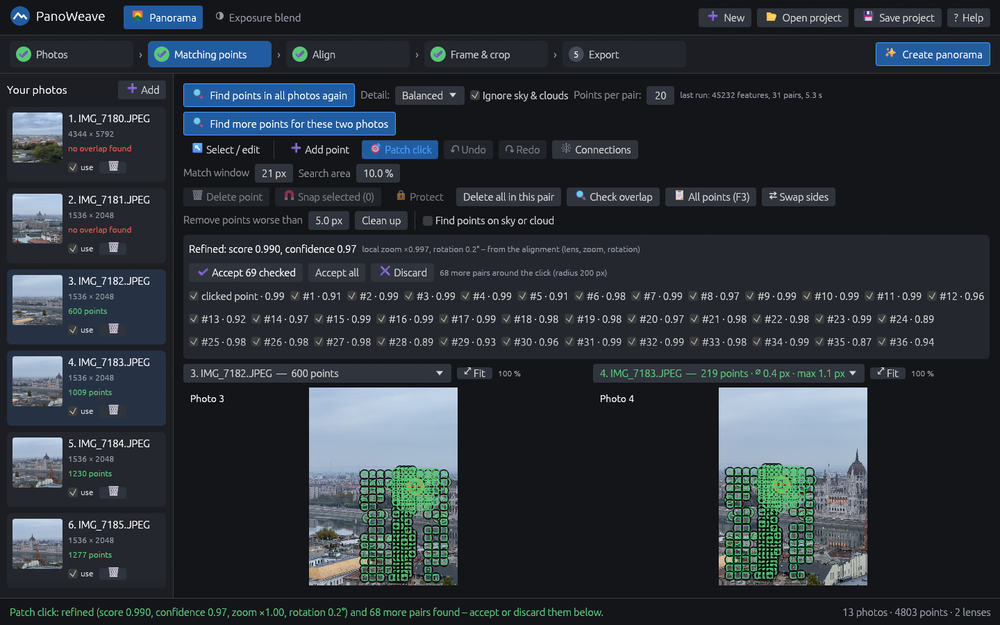
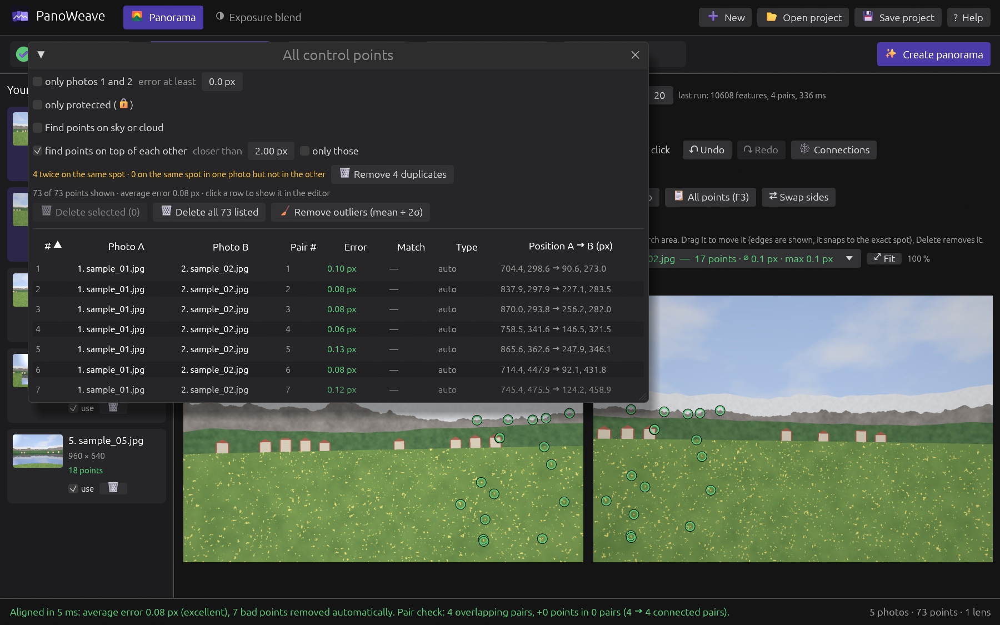
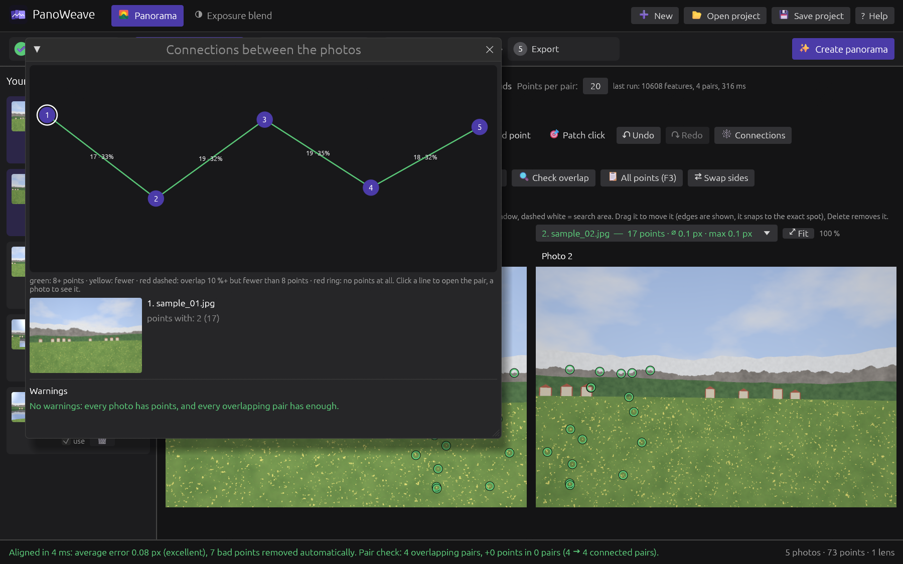
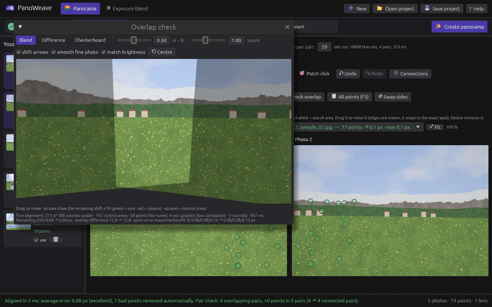
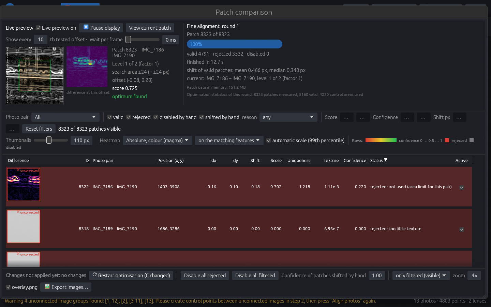

# PanoWeave user guide

This guide explains how PanoWeave works, what each step and setting does, and what to do when a panorama does not come out right. It describes version 0.3 (alpha); the program changes quickly, so if something here does not match what you see, the program is right and this guide is out of date.

**Contents**

1. [Quick start](#1-quick-start)
2. [Taking photos that stitch well](#2-taking-photos-that-stitch-well)
3. [The five steps](#3-the-five-steps)
   - [Step 1: Photos](#step-1-photos)
   - [Step 2: Matching points](#step-2-matching-points)
   - [Step 3: Align](#step-3-align)
   - [Step 4: Frame & crop](#step-4-frame--crop)
   - [Step 5: Export](#step-5-export)
4. [The point editor in detail](#4-the-point-editor-in-detail)
5. [Windows and tools](#5-windows-and-tools)
6. [Exposure blend](#6-exposure-blend)
7. [Projects](#7-projects)
8. [Pitfalls and how to solve them](#8-pitfalls-and-how-to-solve-them)
9. [What the messages mean](#9-what-the-messages-mean)
10. [Keyboard and mouse](#10-keyboard-and-mouse)

---

## 1. Quick start

1. Start PanoWeave and drop your photos onto the window (or click **Add**).
2. Press **✨ Create panorama** (top right). PanoWeave finds matching points, aligns the photos, chooses a projection and a crop, and takes you to step 4.
3. Look at the preview. If it looks right, go to **Export**, choose size and file type, and press **Export panorama**.

That is all for most panoramas. Everything below is for when you want more control or something goes wrong.

The bar at the bottom of the window is the **status line**. It always says what just happened, and it is where warnings appear. Read it after every step.

---

## 2. Taking photos that stitch well

PanoWeave can only join what the photos allow. Most problems in the result start when the photos are taken.

- **Overlap.** Neighbouring photos should overlap by about a third. Less than 15 % makes it hard to find enough common points.
- **Turn around the lens, not around yourself.** For distant scenes it does not matter. For anything close (a fence, a lamp post, people in the foreground) the point you turn around matters: turn the camera around the lens (on a tripod: a panorama head), not around your body. Otherwise close objects shift against the background between photos (**parallax**), and no program can make both line up.
- **Keep the settings fixed.** Same zoom, focus, and, if you can, a fixed exposure and white balance. Auto exposure is corrected by the brightness matching, but large jumps can still show.
- **Moving things.** People, cars, water and clouds move between shots. PanoWeave ignores points on sky and clouds by default, and the seams try to avoid cutting through differences, but a person who appears in two places in two photos may still appear twice ("ghosting"). Masks (step 5) let you say which photo to use there.
- **Mixed lenses or zoom levels** work (each focal length becomes its own lens), but they are harder to match. See [Pitfalls](#8-pitfalls-and-how-to-solve-them).

---

## 3. The five steps

The step bar at the top shows where you are. A green tick means the step is done. You can go back to any step at any time; when a later step needs to be redone, the program says so ("Something changed – align again to update.").

**✨ Create panorama** runs steps 2 to 4 automatically. You can always correct things afterwards and run single steps again.

### Step 1: Photos

- **Add / Add more** loads photos. JPEG, PNG, TIFF and camera RAW files are read; the EXIF rotation is respected.
- **The photo list (left)** shows every photo with its size and, once points are found, its number of points. "no overlap found" in red means this photo has no points to the main group of photos.
- **use** takes a photo out of the panorama without removing it. It is locked while a job runs.
- **🗑** removes the photo from the project.
- **Right-click a photo** for more: photo info, show in folder, use as left/right photo in the point editor, edit or clear masks, disable, remove.
- **Lens.** Photos with the same focal length and size share one lens. The field of view is read from the photo information (EXIF) when it is there ("fixed / from photo info"); **measure instead** lets the alignment measure it. Without EXIF data the alignment measures it anyway.
- **Find points only** runs step 2 without aligning.

### Step 2: Matching points

Matching points (control points) are spots that show the same thing in two photos. The alignment is computed from them, so their quality decides the result.

**Finding points automatically**

- **🔍 Find points in all photos again** searches all photo pairs. It replaces the automatic points; points placed by hand and protected points are kept.
- **Detail:** *Fast*, *Balanced* (default) or *Thorough (difficult scenes)*: how many features per photo are looked at. Thorough is slower and helps with little texture or very different photos.
- **Ignore sky & clouds** (on by default): clouds move between shots, so points on them pull the photos apart. Turn it off only if the sky is the only overlap.
- **Points per pair:** how many points are kept per pair (8 to 300). More points do not make the alignment much better once each pair has a few dozen good ones.
- **🔍 Find points for these two photos** (or *Find more points…* when the pair has points already) searches only the pair on screen.

**The two photos on screen** are chosen with the drop-downs above them (or by clicking a pair in the [connection graph](#connections)). **⇄ Swap sides** swaps them. How to edit points is described in [section 4](#4-the-point-editor-in-detail).

**Cleaning up**

- **Remove points worse than … px → Clean up** deletes points with a large alignment error (after aligning). Protected points stay.
- **Delete all in this pair** deletes the points of the pair on screen (protected points stay).
- **Find points on sky or cloud** finds points that still sit on sky (placed by hand, from the patch click, from old projects). The photos are checked once ("Check N photos"); the threshold sets how much sky around a point counts. **Remove N** removes them as one undo step. Points placed by hand are only removed with "include points placed by hand"; protected points never. When nothing can be removed, the button says why.

### Step 3: Align

**📐 Align photos** works out in which direction each photo was taken, the field of view of each lens and its distortion. The result shows the **average error** (in pixels of the original photos) and the **worst point**:

- below 1.5 px: excellent; below 3 px: good; above: check the points.
- "N points removed in M passes": points that did not fit were taken out (only real points; control areas are rebuilt by the fine alignment and not counted). The check runs again each time the pair check adds points, so M can be more than 1. Undo (Ctrl+Z) brings them back.
- The average error is measured on the points that are left. Aligning again removes more points each time, so the number keeps dropping even when the panorama does not get any better (measured: 0.60 → 0.54 px after three runs, the real fit unchanged). Judge the result by the seams in **Check overlap** or in the export, not by this number alone. To measure the real fit, see "Measuring the fit" in the pitfalls.

Next to **📐 Align photos**: **🔬 Patch comparison** (the patches of the fine alignment), **🖌 Masks** (the mask editor, also in the export step) and **⟲ Level the horizon**.

**Options**

- **Measure the lens field of view precisely** and **Correct lens distortion**: let the alignment change the lens. Leave on unless a lens is known exactly.
- **Remove wrong matches automatically**: drops points that do not fit the others.
- **Level the horizon automatically**: turns the panorama so that the horizon is level. **⟲ Level the horizon** does it again later.

**Pair check** (on by default): after aligning, PanoWeave knows which photos overlap. Pairs that overlap but have too few points are searched again: first the normal point finder inside the overlap only, then a prediction through a third photo, then patch matching. Points the pair already has are not counted again ("n already there" in the pair's report), so a pair only counts as solved by really new points. Pairs that still have too few points are reported, nothing is made up.

**Fine alignment (patch matching)** compares small image patches in the overlaps after aligning and refines the alignment in rounds, for sharper seams. A round that makes the result worse is undone ("The last round was undone…"). The main switches:

- **Refine control points**: moves automatic points to the exact spot. Points placed by hand stay where you put them; protected points are never moved, but if one is more than 3 px off (or cannot be found nearby) the status line says so.
- **Add control areas in the overlaps**: adds measured patches along the seams. The rounds are judged on these areas; without them the fine alignment changes nothing (and says so).
- **Parallax mode** (off by default): a local correction near the seams for close objects. It is saved in the project.
- **Record patches for this window**: keeps the measured patches for the **🔬 Patch comparison** window. Switching it off saves time and memory and does not change the result.

The many numbers under "Fine alignment" are for difficult cases; **Reset to defaults** brings them back.

### Step 4: Frame & crop

The preview shows the whole panorama.

- **Projection**: how the sphere around the camera is laid flat.
  - *Spherical (360°)*: full 360° or very tall panoramas.
  - *Cylindrical*: wide panoramas of normal height; vertical lines stay straight.
  - *Flat (rectilinear)*: like one big photo; straight lines stay straight, but it cannot show more than about 120° and stretches the edges.
  - *Mercator*, *Little planet / stereographic*, *Fisheye*: special looks.
- **Drag** to move the view, **Shift+drag** to tilt it, **scroll** to zoom.
- **Crop**: drag the white frame's edges. **✂ Auto crop** finds the largest rectangle without empty edges, **No crop** shows everything, **⤢ Fit to photos** shows all photos.
- **Match brightness**, **Show photo borders**: preview helpers.

### Step 5: Export

**Size.** The slider sets the size as a percentage of full detail (the size at which the photos keep all their pixels). **More size and file options** lets you give a width in pixels and use 16-bit TIFF. The dialog shows the size in megapixels, the memory the export will use and the file size, and checks the free disk space before it starts.

**File.** JPEG (with quality), PNG or TIFF; PNG and TIFF keep the transparent area outside the panorama. The extension of the file name follows the file type (the step shows "Will be saved as …" with the final name), and it says when an existing file will be replaced. JPEG files can be at most 65535 pixels wide or high; TIFF files above 3.5 GB are written as BigTIFF.

**Blending**

- **Smooth seams (recommended)**: blends every detail level separately, so seams disappear.
- **Soft fade**: faster, but can show ghosting with moving subjects.
- **Match brightness and colour between photos**: one correction per photo.
- **Smooth brightness correction across each photo**: evens out sky gradients, vignetting and auto exposure inside each photo, so the outlines of single photos do not show as rectangles.
- **Lens correction (response curve + vignetting per lens)**: an experiment, off by default. It helped on one test set and not on another.
- The brightness values are worked out in the background (after aligning, opening a project, turning the view in step 4 or changing these switches; up to about a second with the lens correction). Meanwhile the preview keeps the old brightness and **Export panorama** is greyed out for that moment.
- **Use the sharpest photo where photos overlap**, **Sharper resampling**: detail options, on by default.
- **Smart seams** (off by default, only with Smooth seams): searches, once for the whole panorama, where the photos agree, so close objects seen from two sides (poles, lamps, people) are not cut in two.
- **Masks** ("🖌 Edit masks…" here, or "🖌 Masks" next to "Patch comparison" in step 3): paint where a photo must (green) or must not (red) be used, for example to keep a pole or a person whole, or to take out a boat that moved. **Red** means the spot does not exist for that photo: nothing of it gets into the panorama, also not blurred by the blending, and another photo fills it. Where **every** photo is red there is nothing left: the panorama has a hole there (transparent in PNG and TIFF, black in JPEG). The preview and "Frame & crop" show such holes, and a warning says how big they are; "Auto crop" ignores them so a small hole does not cut the panorama down. **Green** steers the seams (Smooth seams only). The editor starts with the red brush; the active tool is the filled button with a dot, so green and red are not mixed up by mistake. Note that a moving thing (a boat, a person) is usually in several photos at almost the same place: mask it red in **each** photo that shows it, otherwise the next photo shows it again ("Show seams" tells which photo wins there). "Show seams" shows which photo wins where, in a wide view under the photo. Masks are saved in the project.

The export is made strip by strip and written straight to the file, so it works with little memory; the strip height never changes a pixel. **Cancel** stops it within about a second, and a cancelled or failed export never leaves a half-written file.

---

## 4. The point editor in detail

The point editor (step 2) shows two photos side by side.

**Moving around:** scroll to zoom, drag with the right mouse button (or on empty space) to move the photo, double-click to fit (**⤢ Fit**).

**Select / edit** (the default tool) and its selection shapes:

- **Click** a point to select it. The red square is the match window, the dashed white square the search area. **Drag** a point to move it; it snaps to the exact spot when you let go. **Delete** removes it.
- **Shift+click** or **Ctrl+click** adds a point to the selection or takes it out.
- **Rectangle**: drag on empty space to select the points inside. Shift adds, Ctrl takes out.
- **Lasso**: the same lasso as in the mask editor. Drag around an area on empty space (the points inside are selected when you let go), or click corner by corner and close with a double click or Enter. Esc cancels, Ctrl+Z takes the last corner back. Shift adds, Ctrl takes out. Clicking or dragging a point itself still selects or moves it, unless a lasso is already being drawn.
- **Brush**: click or paint to select the points under the brush (radius next to it).
- **Delete selected** removes all selected points as one undo step.
- **🧲 Snap selected** lets all selected points snap to the exact spot in the background (only results with at least 80 % match are taken; protected points are left alone).

**➕ Add point:** click a distinctive spot (a corner, a sharp detail) in one photo, then the same spot in the other; both clicks snap to the exact spot. With **then find more automatically** PanoWeave grows more points around it.

**🎯 Patch click:** click roughly the same spot in both photos. PanoWeave uses the rotation and zoom of nearby points (and of the alignment) to find the exact spot, even when the photos are turned or zoomed differently, and suggests more pairs around it. Check the suggestions and press **✔ Accept** or **✖ Discard**. Nothing is added without your click.

**🔒 Protect** (key **L**): a protected point is never removed or moved by any automatic or bulk action (clean up, delete all in a pair, outlier removal, duplicate removal, a new search, the fine alignment). Single delete and drag are refused until you unprotect it.

**Undo / Redo** (Ctrl+Z / Ctrl+Y) work for every change of the points, also from the other windows.

---

## 5. Windows and tools

### All points (F3)

A sortable list of all points with their pair, error, match and kind. Filters: one pair, error above a value, only protected, only duplicates, only on sky. Click a row to show the point in the editor; Ctrl+click toggles a row, Shift+click selects a range. **Delete selected**, **Delete all N listed** and **Remove outliers (mean + 2σ)** act on the list (protected points stay). **Duplicate points** (two points of a pair on the same spot) are marked orange and can be removed with one click (the worse one goes; hand-placed points stay).

### Connections

A graph of all photos: lines are pairs with points (green: enough, yellow: fewer), red dashed lines are pairs that overlap but have too few points, a red ring is a photo without any points. Click a line to open the pair in the point editor, click a photo to see it. If the photos fall into separate groups, the window says which and offers **Join photos …**, which opens the patch click mode for the first two groups.

### Check overlap

Lays the two photos of the pair on screen over each other (blend, difference, checkerboard) with matched brightness. Arrows show the remaining shift found by the fine alignment (green = sure, red = unsure). Useful to see whether a pair is really aligned and where it is not.

### Patch comparison

Shows every patch the fine alignment measured: where it was, how well it matched, and why a patch was rejected. You can shift a patch by hand, disable it and restart the optimisation from there. A shift made while the alignment is still running is kept (the running round no longer overwrites it). Needs "Record patches for this window" in the fine alignment settings.

---

## 6. Exposure blend

The **Exposure blend** mode (top of the window) merges photos of the same view taken at different exposures into one evenly lit picture (exposure fusion). Add the brackets, choose whether to align handheld shots, look at the preview and export. The file type follows the extension of the file name.

---

## 7. Projects

**💾 Save project** writes a `.pwproj` file with the photos (as paths), lenses, points, alignment, framing, masks and the parallax correction. **Open project** loads it again.

- The photos are not copied into the project; keep them where they are. If photos are missing when a project is opened, the others keep their points and alignment, the status line names the missing files, and the next save asks for a new file name so the complete project is not overwritten.
- Sample photos (from "Try it with sample photos") are saved next to the project when it is saved.
- Saving writes a temporary file first and only then replaces the old project, so a failed save never destroys the old file.

---

## 8. Pitfalls and how to solve them

**"Warning: N unconnected image groups found"**
Some photos have no points to the others. Common reasons: too little overlap, very different zoom, a featureless overlap (sky, water, a white wall). Open the **Connections** window, use **Join photos …** or the patch click mode to place a few points between the groups by hand, then align again. A photo that does not belong to the panorama can be unticked ("use").

**Points on clouds, water or moving people**
They pull the photos apart, because those things moved between shots. Keep "Ignore sky & clouds" on, use **Find points on sky or cloud** to remove old ones, and delete points on people or waves by hand (select them with the lasso or brush and press Delete).

**Seams or double edges on close objects (parallax)**
The photos were not taken around the lens. Try the **Parallax mode** in the fine alignment, **Smart seams** and masks in the export, and avoid points on close objects (they cannot fit both the near and the far parts).

**A high average error after aligning**
Look at the worst points: open **All points (F3)**, sort by error, check the top ones in the point editor and delete wrong ones, or use **Clean up**. Then align again.

**Measuring the fit (for testing and comparing settings)**
`panoweave --accuracy <photos>` (command line, no window) aligns the photos like the **Align** button and then measures how far the photos are still apart in their overlaps, on spots that are neither points nor control areas. Removing points cannot make this number better, so it shows whether a setting really helps. It measures on 3200 px copies of the photos, because on the 1600 px working images part of the number is the inaccuracy of the measurement itself (0.40 instead of 0.27 px on the test photos); the photos are therefore loaded a second time and it takes a little longer. It prints the median and the worst 10 % (in pixels of the 1600 px working image) and, with `PW_ACC_PAIRS=1`, every photo pair, worst first. On the test photos: about 0.3 px for a still scene; pairs with near trees (probably parallax or wind) reach 1.5–2.5 px, which no alignment setting removes (use the Parallax mode, masks and smart seams there).

**Protected point reported "off by more than 3 px"**
A protected point that the fine alignment finds elsewhere. It is left alone; check it in the point list ("only protected") and move or unprotect it if it is wrong.

**Different lenses or zoom levels in one panorama**
Each focal length gets its own lens, which works, but points between very different zoom levels are harder to find. Use *Thorough* detail, or place a few points by hand with the patch click mode, which handles different zoom.

**Visible brightness steps or rectangles in the sky**
Keep "Match brightness and colour" and "Smooth brightness correction" on. Very different exposures can still show; shoot with fixed exposure if you can.

**Ghosting (things appearing twice or half transparent)**
Use *Smooth seams* rather than Soft fade, try Smart seams, and paint masks to say which photo should be used where.

**Little memory or a huge panorama**
The export works in strips and adapts to the free memory, so it finishes, just slower. Choose a smaller size if the file would be very large; JPEG is limited to 65535 pixels per side, TIFF is not.

**RAW photos**
RAW files are developed with neutral settings. For the best colours, develop them yourself and stitch the JPEG or TIFF files.

**The program says a job failed with an internal error**
Nothing was changed. The status line names a `crash.log` file (in `%APPDATA%\PanoWeave`); please attach it when you report the problem.

---

## 9. What the messages mean

| Message | Meaning |
|---|---|
| no overlap found (photo list) | The photo has no points to the main group. |
| N points removed in M passes | The alignment dropped N points that did not fit, over M alignment passes; Ctrl+Z brings them back. |
| Something changed – align again to update. | Points or photos changed after aligning. |
| The last round was undone because it made the result worse. | Fine alignment kept the better earlier state. |
| N protected point(s) are off by more than 3 px … | The fine alignment found a protected point elsewhere; the point was left alone. |
| N protected point(s) could not be confirmed (3 repeating pattern, 1 too close to the photo edge, …) | The patches around the point do not look alike at the point's own spot. The reason is given per count: repeating pattern, too close to the photo edge, too little texture, too little similarity. Not a sign that the point is wrong; it was left alone. |
| fine alignment changed nothing: no control areas … | "Add control areas" is off, so there was nothing to judge the rounds with. |
| Project opened with N of M photos – missing: … | Some photo files were not found; the others were opened with their points. |
| … failed with an internal error … | A program error in a background job; nothing was changed. |
| Masks leave a hole (about N % of the picture) … | Every photo is masked red at some spot, so nothing covers it; it stays empty. Remove a red mask there or keep a photo that covers it. |
| Patch N: the shifted spot lies outside photo B (patch list: "shifted by hand outside photo B") | A patch was dragged so far that its spot left photo B; it cannot be used and is marked rejected. Drag it back or reset it. |

---

## 10. Keyboard and mouse

Shortcuts do nothing while a text or number field has the keyboard focus (there Ctrl+Z undoes your typing). On a Mac, Cmd works instead of Ctrl.

**Everywhere (panorama mode)**

| Key / action | What it does |
|---|---|
| Ctrl+Z | Undo the last change of the points (also from the point list, the patch window and the other windows) |
| Ctrl+Y or Ctrl+Shift+Z | Redo |
| F3 | Open or close the list of all points |
| Right-click a photo (photo list) | Photo menu |

**Point editor (step 2)**

| Key / action | What it does |
|---|---|
| Scroll | Zoom at the mouse position |
| Double-click | Fit the photo into its half (same as **⤢ Fit**) |
| Drag on empty space | Move the photo (with **Select / edit** set to Click) |
| Right-button drag | Move the photo, also while Rectangle, Lasso or Brush is chosen |
| Click a point | Select it; the partner in the other photo is centred when that half is zoomed in |
| Drag a point | Move it; it snaps to the exact spot when you let go (protected points stay) |
| Shift+click, Ctrl+click a point | Add it to the selection or take it out |
| Rectangle: drag | Select the points inside; Shift+drag adds, Ctrl+drag takes out |
| Lasso: drag, or click corners | Select the points inside (when you let go, or on double-click / Enter); Shift adds, Ctrl takes out; Esc cancels, Ctrl+Z removes the last corner |
| Brush: click or paint | Select the points under the brush; Ctrl takes out |
| Delete or Backspace | Delete the selected point(s); protected points stay and are named |
| L | Protect / unprotect the selected point (the one clicked last, not a multiple selection) |
| Esc | **Add point**: cancel a half-placed point (the first click); pressed again, or in any other tool, back to **Select / edit** |

**All points list (F3)**

| Key / action | What it does |
|---|---|
| Click a row | Show the point in the point editor |
| Ctrl+click | Add the row to the selection or take it out |
| Shift+click | Select the range up to this row |
| Click a column header | Sort by it, click again to reverse (error: worst first) |

**Frame & crop (step 4)**

| Key / action | What it does |
|---|---|
| Drag | Turn the view (move the panorama) |
| Shift+drag | Tilt (roll) the view |
| Drag near the white frame | Move that crop edge |
| Scroll | Zoom |

**Masks**

| Key / action | What it does |
|---|---|
| Left button | Paint or draw with the chosen tool |
| Lasso: drag | Draw around an area; it is masked when you let go (the lasso of the point editor works the same way) |
| Lasso: click | Set a corner; double-click or Enter closes the shape |
| Esc | Throw away the shape that is being drawn |
| Ctrl+Z | While drawing a lasso: remove the last corner; otherwise undo the last mask change |
| Ctrl+Y or Ctrl+Shift+Z | Redo a mask change |
| Right- or middle-button drag | Move the photo |
| Scroll | Zoom |

The masks keep their own undo history, separate from the points. The keys work while the mouse is over the mask picture (or, in its own window, while that window has the focus).

**Patch comparison window**

| Key / action | What it does |
|---|---|
| Click a row | Open that patch in the detail view |
| Ctrl+click, Shift+click | Add to the selection / select a range |
| Right-click a row | Disable, enable or reset the selected patches |
| Page Up / Page Down | Previous / next patch |
| Arrow keys (side by side, wipe) | Previous / next patch |
| Arrow keys (overlay view) | Shift photo B against A by 1 px; Shift: 0.1 px, Ctrl: 10 px |
| Drag photo B (overlay view) | Shift it by hand |
| Drag (wipe view) | Move the wipe line |

**Check overlap**

| Key / action | What it does |
|---|---|
| Drag | Move the picture |
